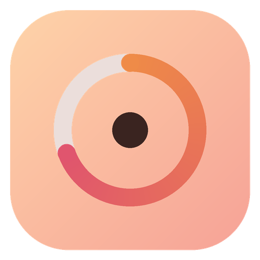
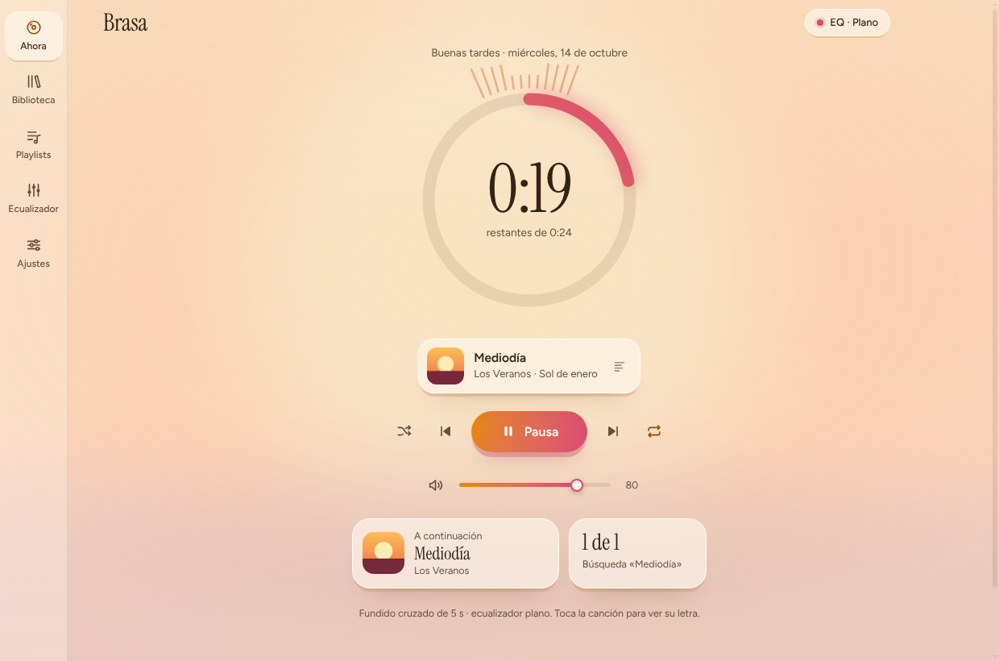
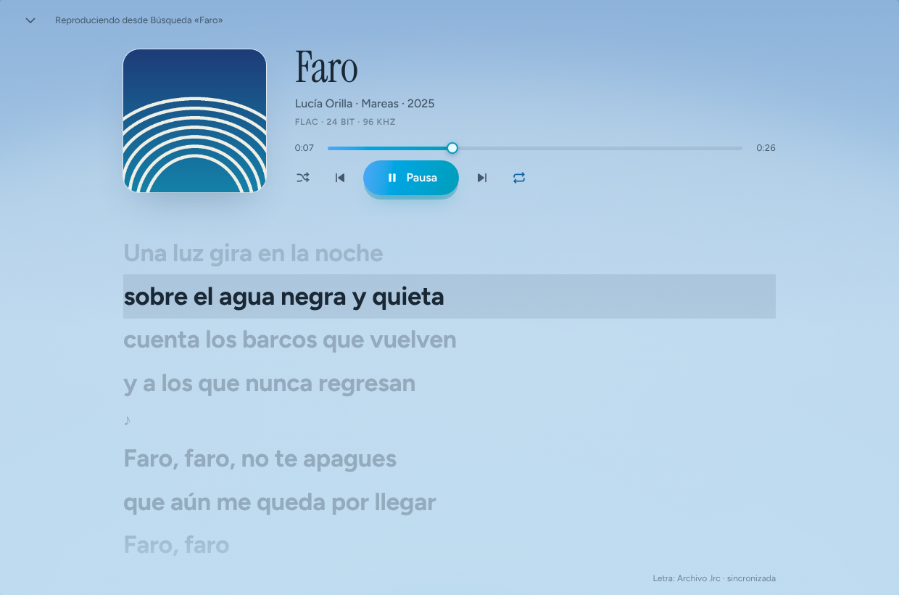
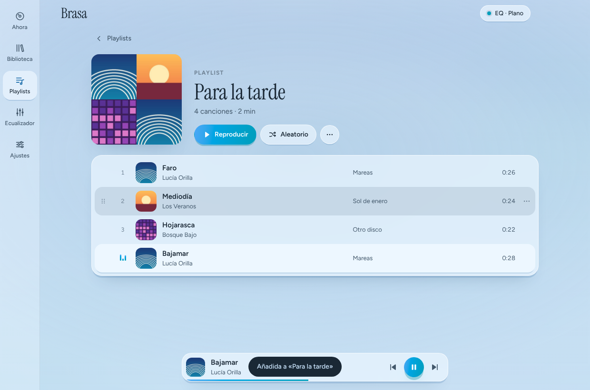
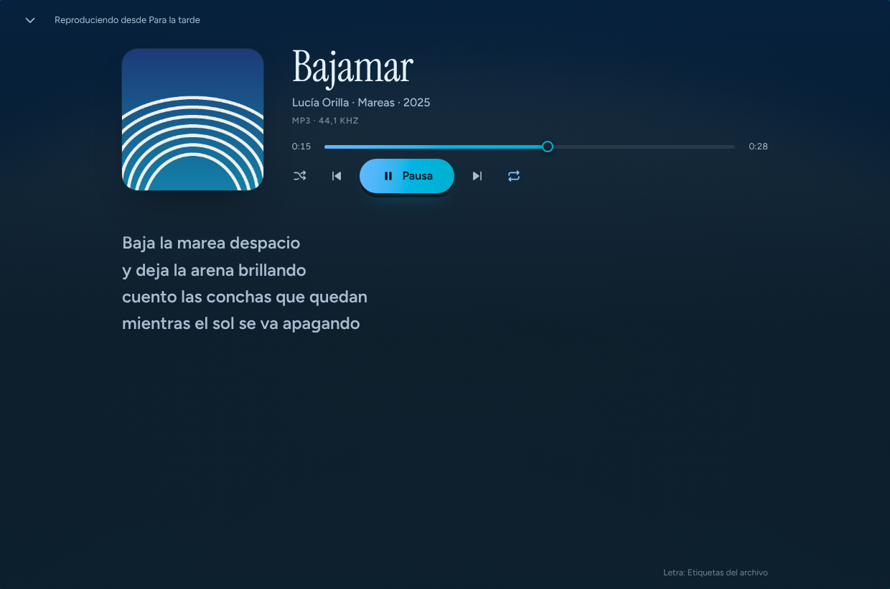

<p align="center">
  
</p>

<h1 align="center">Brasa</h1>

<p align="center">
  A local music player for the desktop, with a calm interface that takes on the colours of the album art that's playing.<br>
  10-band equalizer · crossfade and gapless playback · playlists · synced lyrics · any audio format.
</p>

<p align="center">
  <a href="../../releases/latest"><b>Download for Windows</b></a> ·
  <a href="#build-from-source">Build from source</a> ·
  <a href="#features">Features</a>
</p>

<p align="center">
  
</p>

> The app's interface is currently in Spanish.

## Screenshots

| Full-screen synced lyrics | Playlists |
| --- | --- |
|  |  |

<p align="center">
  <br>
  <sub>Dark mode. The whole interface follows the colour of the album art.</sub>
</p>

## Features

- **Your music, on your computer.** Add your music folders and Brasa rescans them every time it opens. It reads title, artist, album, track number, cover art and ReplayGain from the tags. If a song has no embedded cover, it uses the `cover.jpg` or `folder.jpg` in its folder.
- **Any format.** MP3, AAC/M4A, FLAC, OGG, Opus and WAV play directly. WMA, ALAC, AIFF, APE, WavPack, DSD (DSF/DFF), Musepack, TTA, AC-3, DTS and the rest are converted losslessly to FLAC by the bundled FFmpeg the first time they play.
- **Album-art colours.** The two dominant hues of the cover are extracted in the OKLCH colour space, and the whole interface shifts to them with a smooth transition, in both light and dark mode. The cover also appears blurred in the background.
- **Lyrics.** Click the song that's playing to open it full screen with the lyrics below. Synced lyrics highlight the current line, and clicking a line jumps the song to that point. Brasa looks for lyrics in a `.lrc` file next to the song, in the file's tags and, if you enable it, on [LRCLIB](https://lrclib.net).
- **Transitions.** Fade-in, fade on pause, and crossfade adjustable from 0 to 12 s with a constant-power curve. At 0 s, songs play back to back with no silence, which suits live albums and continuous mixes.
- **Equalizer.** 10 bands of ±12 dB, a preamp, 7 presets and a live frequency-response curve. A limiter keeps boosted bands from clipping.
- **Volume levelling.** Uses ReplayGain, or measures each song's EBU R128 loudness, so the volume doesn't jump between songs.
- **Playlists.** Create, rename, reorder by dragging, and import or export `.m3u` / `.m3u8`.
- **System integration.** Media keys and system media controls with cover art, "Open with" for audio files, and keyboard shortcuts for everything.

## Installation (Windows)

1. Download `Brasa-Setup-x.y.z.exe` from the [latest release](../../releases/latest).
2. Run it. Windows SmartScreen will warn that the app isn't signed: click **More info** and then **Run anyway**.
3. Choose the install folder. You'll get shortcuts on the desktop and in the Start menu.

On macOS and Linux, [build it from source](#build-from-source) for now.

## Build from source

You need [Node.js](https://nodejs.org) 20 or later.

```bash
git clone https://github.com/<your-username>/brasa.git
cd brasa
npm install      # downloads Electron, FFmpeg for your OS and the tag reader
npm start        # runs the app in development mode
npm run dist     # builds the installer in dist/ (.exe on Windows, .dmg on macOS, .AppImage on Linux)
```

`npm install` downloads FFmpeg for the operating system it runs on, so build each installer on its own OS.

## Keyboard shortcuts

| Key | Action | Key | Action |
| --- | --- | --- | --- |
| `Space` | Play or pause | `L` | Open lyrics |
| `←` `→` | ±5 s (`Shift`: ±30 s) | `S` | Shuffle |
| `N` / `P` | Next / previous | `R` | Repeat mode |
| `↑` `↓` | Volume | `Ctrl` `F` | Search the library |
| `M` | Mute | `Esc` | Close view or menu |

## How it works

Brasa is an [Electron](https://www.electronjs.org) app with no UI framework: plain HTML, CSS and JavaScript.

- **Audio engine:** two `<audio>` elements wired into Web Audio take turns. While one plays, the other preloads the next song, which is what makes crossfade and gapless playback possible. The 10 filters, the limiter and the spectrum analyser sit after them.
- **Custom `brasa://` protocol:** serves the interface, the audio (with range requests, so you can seek anywhere) and the cover art without exposing the file system to the interface.
- **Colours:** `palette.js` analyses the cover and sets just three CSS variables: `--h` (hue), `--h2` (second hue) and `--c` (colourfulness). Every colour in the app is derived from them with `oklch()`.

```
main.js          main process: library, protocol, FFmpeg, lyrics, playlists
preload.js       secure bridge between the interface and the main process
renderer/
  app.js         interface, virtual lists, playlists and lyrics view
  engine.js      audio engine
  palette.js     colour extraction from album art
  styles.css     styles
build/           icons
```

### Where data is stored

In `%APPDATA%\Brasa` (Windows), `~/Library/Application Support/Brasa` (macOS) or `~/.config/Brasa` (Linux): the library and playlists in `biblioteca.json`, plus cover art, downloaded lyrics and converted files. **Brasa never modifies your music files.**

### Privacy

Brasa sends no data anywhere except to look up lyrics on LRCLIB, which receives only the song's title, artist, album and duration. You can turn this off in **Ajustes → Letras** (Settings → Lyrics).

## Known limitations

- DRM-protected songs (such as old iTunes `.m4p` files) can't be played.
- Some files without a complete header show their duration only after they first play.
- The installer isn't code-signed.

## License

Brasa's code is released under the [MIT License](LICENSE).

It includes third-party software under its own licences:

- [FFmpeg](https://ffmpeg.org), distributed through [ffmpeg-static](https://github.com/eugeneware/ffmpeg-static), under the GPL. It runs as a separate program, and its licence and a link to its source code ship alongside the binary.
- [music-metadata](https://github.com/Borewit/music-metadata), under the MIT License.
- The [Figtree](https://fonts.google.com/specimen/Figtree) and [Instrument Serif](https://fonts.google.com/specimen/Instrument+Serif) typefaces, under the SIL Open Font License.
- Lyrics from [LRCLIB](https://lrclib.net) belong to their respective authors.
